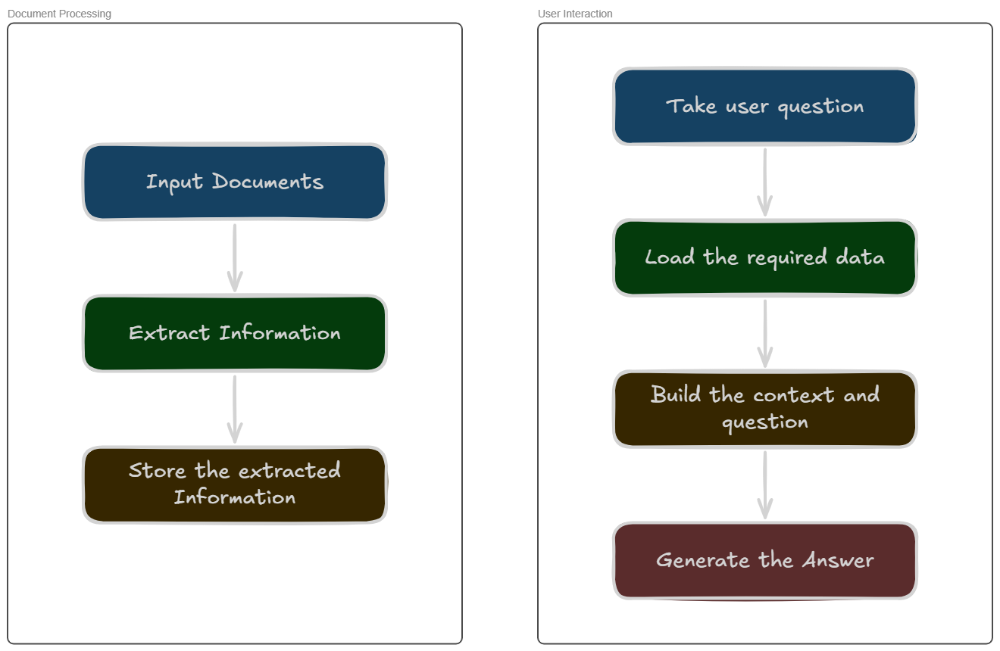
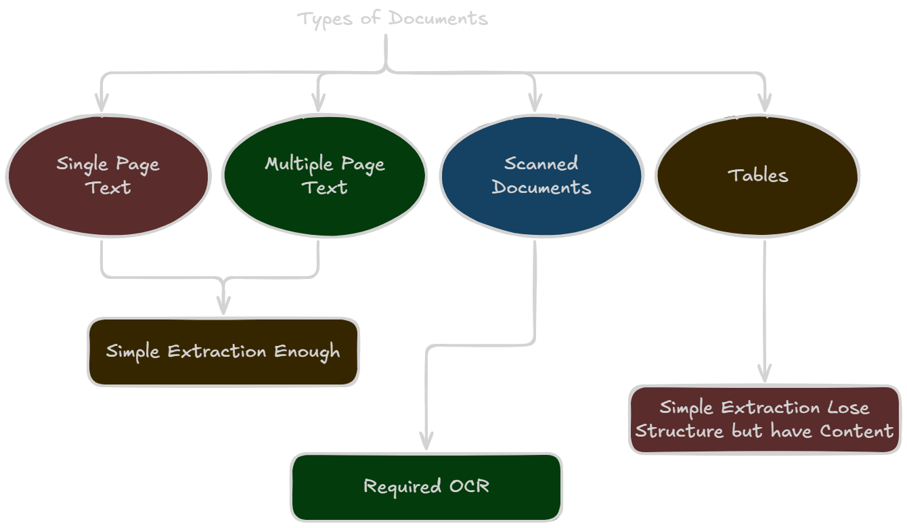
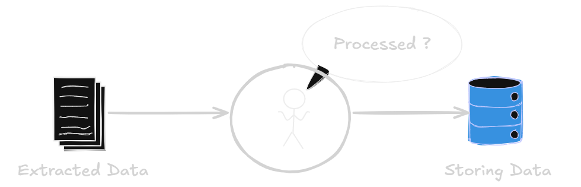
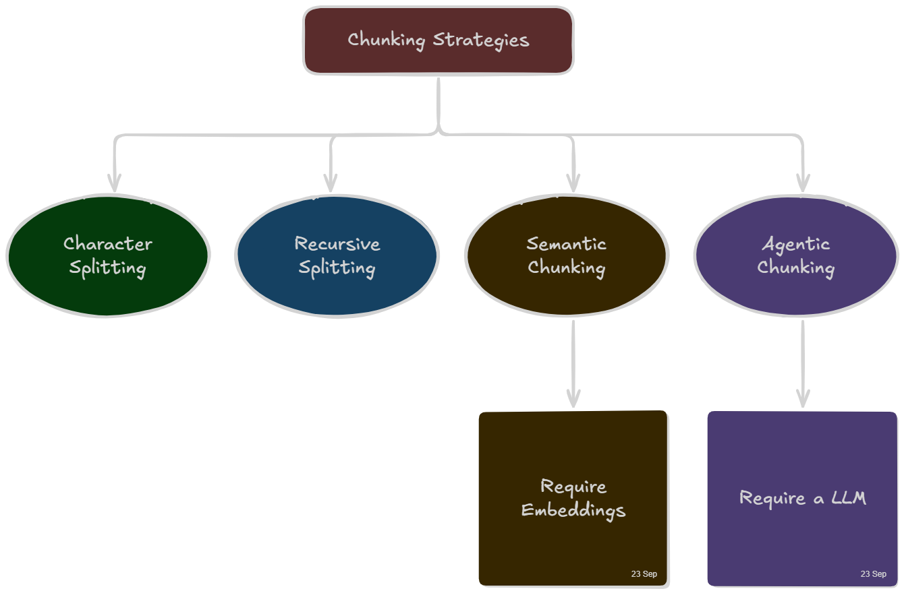
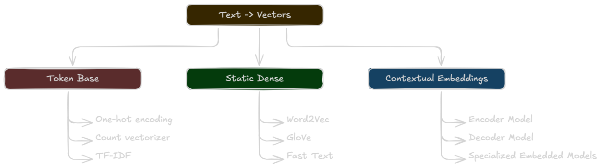

# Document Intelligence Project

The purpose of building this project is to understand how documents
being processed in intelligent systems and how the processed information
being used to take business decisions. For the sake of learning, this
project will focus on a specific industry such as education. This
project will process documents that are given and answer questions
according to the information presented in the documents provided.

- Author: Poorna Rajapaksha

- Start Date: 22 September 2026

This document has been used to document the learning process and
experience.

---

At this moment, I don't understand how this whole system works. But I
have a general understanding of what should be happening in this system.

Therefore, according to the above illustrations I can identify 2
different processes such as,

1.  Document Processing Process

2.  User Interaction Process

These are **not** **independent processes**. They are processes that
happen one after another and have a strong dependency on each other to
function as a proper system. Because the document processing is useless
if there are no user interactions to answer questions. Also, the user
interaction process cannot be accurate if there are no accurate data
extractions from the given sources.

# Phase 1 - Understanding Documents

A pdf document can be categorized into 2 groups,

1.  **Text Documents** - Easy to process

2.  **Scanned Documents** - Now the computer sees the document as images.
    To process those documents, we need OCR (Optical Character
    Recognition).

But for the initial phase, this project will only focus on text documents.

Right now I have implement text based pdf text extractions. This also have proper exceptions without exposing low-level system exceptions. 

I have also implement a basic `CI` action in github to check weather all tests are being passed during commits and pull requests.

> Now we should think what should happen after text extraction before chunking and storing

We need to do this cleaning process just to remove and clean structural issues in a document. We should not do a hard cleaning process because that might destroy the useful context of the document.

Therefore, the system have a simple cleaning process which includes,
- Normalize line endings
- Remove leading/trailing whitespace from the entire text
- Remove leading/trailing whitespace from each line
- Normalize repeated spaces/tabs within each line
- Collapse 3+ consecutive newlines into 2

# Phase 2 - Chunking

> Chunking means breaking a large document into **smaller meaningful pieces of text**

Let's say we have a document, and we ask a specific question based on that document. The system should not send the entire document for the LLM as **context**. This will be fine if the document is small but for larger document it's not practical.

With chunking we brake large documents into meaningful groups. And when a question is asked, we retrieves only the required chunks and send them as the **context** for the LLM.

There are few different `chunking-strategies`:

The **agentic** and **semantic chunking** offers **better results** compared to rest of the chunking strategies. But between **agentic** and **semantic**, **agentic** provides better results.

But for this project we will use **semantic chunking** rather than **agentic chunking** in the V1. Because, with semantic chunking, I will get a better exposure on embeddings.

## Embeddings

> Embedding is a means of representing objects like text, images and audio as points in a continuous vector space.

Text can be converted to vectors using few different methods, 

Each of these methods converts text into vectors in different methods. But after we convert the sentences to vectors we should calculate and group the sentences based on the similarites. To calculate the similarities between sentences, we use `cosine similarity` method.