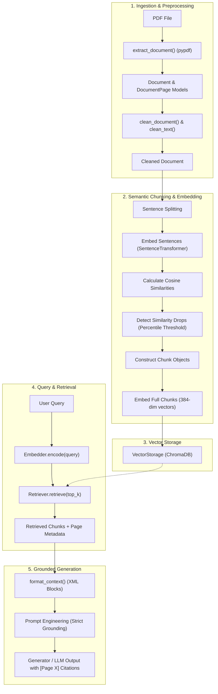

# Document Intelligence System — Scope & Architectural Specification

## 1. Project Overview & Objective

The **Document Intelligence** project is designed to explore and understand how unstructured documents (specifically PDFs) are ingested, cleaned, semantically partitioned, embedded, indexed, and retrieved to enable grounded Question Answering (QA) via Retrieval-Augmented Generation (RAG).

The primary domain used for testing and validation is **academic and educational documentation** (e.g., degree specifications, academic regulations, syllabi).

```
                      +------------------------------------------------+
                      |               DOCUMENT INTELLIGENCE             |
                      +------------------------------------------------+
                                       /              \
                                      /                \
                    +--------------------+          +--------------------+
                    | Indexing Pipeline  |          | Query & Retrieval  |
                    | (Ingest & Store)   |          | (Search & Answer)  |
                    +--------------------+          +--------------------+
```

---

## 2. End-to-End Architecture & Workflow

The system is organized into two primary interconnected workflows:

### A. Document Indexing Pipeline (Offline / Preparation)
1. **Document Ingestion**: Read text-based PDF documents page-by-page.
2. **Text Cleaning**: Normalize line endings, whitespace, and Unicode characters while preserving paragraph breaks.
3. **Semantic Chunking**: Split text into sentences, compute sentence embeddings, detect semantic shifts (cosine similarity drops), and group sentences into coherent topical chunks.
4. **Vector Embedding**: Generate dense vector embeddings for each chunk.
5. **Vector Storage**: Store chunk text, 384-dimensional vector embeddings, and page/file metadata into a ChromaDB collection.

### B. Retrieval & Generation Pipeline (Online / User Interaction)
1. **Query Processing**: Convert the user's natural language question into a dense vector embedding using the same embedding model.
2. **Vector Similarity Retrieval**: Search ChromaDB using cosine distance to retrieve the Top-$k$ most relevant chunks.
3. **Context Formatting**: Structure the retrieved chunks with metadata (source document and page numbers).
4. **Generation & Grounding**: Pass formatted context and query to an LLM with strict instructions for inline citations (`[Page X]`) and hallucination prevention.



---

## 3. Deep Dive into System Components

### 3.1 Data Models (`src/document_intelligence/models/`)

| Model | File | Fields | Description |
| :--- | :--- | :--- | :--- |
| `DocumentPage` | `models/document.py` | `page_number: int`, `text: str` | Represents raw or cleaned text extracted from a single PDF page. |
| `Document` | `models/document.py` | `file_name: str`, `pages: list[DocumentPage]` | Represents an entire ingested document container. |
| `Chunk` | `models/chunk.py` | `text: str`, `sentences: list[str]`, `file_name: str`, `page_no: int` | Represents a semantically cohesive block of sentences within a page. |
| `EmbeddedChunk` | `models/chunk.py` | `chunk: Chunk`, `embeddings: np.ndarray` | Pairs a `Chunk` with its 384-dimensional vector embedding. |
| `RetrievedChunk` | `models/retriever.py`| `text: str`, `file_name: str`, `page_number: int`, `distance: Optional[float]` | DTO representing a retrieved chunk result returned to the generator. |
| `GenerationResponse`| `models/generation.py`| `answer: str`, `cited_pages: list[int]`, `is_grounded: bool`, `raw_response: str` | Structured response from the LLM generator. |

---

### 3.2 Ingestion Layer (`src/document_intelligence/ingestion/pdf.py`)

* **Technology**: `pypdf` (`PdfReader`).
* **Function**: `extract_document(file_path: str | Path) -> Document`
* **Behavior**:
  - Checks if the file exists; raises custom `DocumentNotFoundError` if missing.
  - Iterates over `reader.pages`, calling `.extract_text()` on each page.
  - Wraps underlying `PdfReadError` or `PermissionError` into a domain exception `DocumentReadError`.
* **Scope Constraint**: Text-based PDFs only. Scanned/rasterized PDFs requiring OCR are outside the current scope.

---

### 3.3 Text Preprocessing (`src/document_intelligence/processing/text.py` & `document.py`)

* **Functions**: `clean_text(text: str) -> str` and `clean_document(document: Document) -> Document`
* **Cleaning Steps**:
  1. Standardize line breaks: Converts `\r\n` and `\r` to `\n`.
  2. Unicode normalization: Uses `unicodedata.normalize("NFKC", text)` to resolve ligature issues and irregular character representations.
  3. Whitespace trimming: Trims leading and trailing whitespace from the full text and each line.
  4. Tab/space normalization: Collapses multiple consecutive spaces and tabs (`[ \t]+`) into a single space.
  5. Blank line reduction: Collapses 3 or more consecutive newlines (`\n{3,}`) into 2 newlines (`\n\n`) to retain paragraph separation without excessive vertical gaps.

---

### 3.4 Embedding Layer (`src/document_intelligence/processing/embedder.py`)

* **Technology**: `sentence-transformers` (`SentenceTransformer`).
* **Default Model**: `all-MiniLM-L6-v2` (fast, lightweight, runs locally on CPU, outputs 384-dimensional dense vectors).
* **Key Methods**:
  - `encode(text: str | list[str]) -> np.ndarray`: Produces normalized numpy float arrays representing semantic meaning.
  - `embed_chunks(chunks: list[Chunk]) -> list[EmbeddedChunk]`: Batches chunk embeddings and pairs each chunk with its vector.

---

### 3.5 Semantic Chunking Engine (`src/document_intelligence/processing/semantic_chunker.py`)

Instead of fixed-character splitting (e.g., arbitrary 500 characters) or fixed-token splitting, this project implements **Semantic Chunking**:

1. **Sentence Splitting**: Splits text into sentences on period delimiters (`.`).
2. **Adjacent Pair Similarity**:
   Computes cosine similarity between consecutive sentences:
   $$\text{Cosine Similarity}(u, v) = \frac{u \cdot v}{\|u\| \|v\|}$$
3. **Similarity Drop Calculation**:
   Calculates the difference between adjacent similarities:
   $$\text{Drop}_i = \text{Sim}_i - \text{Sim}_{i+1}$$
4. **Boundary Detection**:
   Computes a threshold using a configurable percentile (default: `80.0`th percentile) of observed drops. Points where the drop exceeds this threshold are marked as topic change boundaries.
5. **Chunk Assembly**:
   Combines sentences between detected boundary indices into cohesive `Chunk` objects containing provenance metadata (`file_name`, `page_no`).

---

### 3.6 Vector Storage (`src/document_intelligence/storage/vector_storage.py`)

* **Technology**: `chromadb` (`PersistentClient` or in-memory `Client`).
* **Default Collection**: `"documents"` (stored under `data/chroma`).
* **Chunk ID Scheme**: Deterministic key format:
  `{file_name}-page-{page_no}-chunk-{index}`
* **Storage Contents**:
  - `ids`: Unique string IDs.
  - `documents`: Plain text of the chunk.
  - `embeddings`: Float list of 384 dimensions.
  - `metadatas`: Dictionary storing `{"file_name": str, "page_number": int}`.
* **Search Function**: Calls ChromaDB's `.query(query_embeddings=[...], n_results=top_k)`.

---

### 3.7 Retrieval & Evaluation Engine (`src/document_intelligence/retrieval/` & `tests/evaluation/`)

* **Retriever (`retriever.py`)**: Coordinates the `Embedder` and `VectorStorage`. Encodes incoming text queries and queries vector storage for the Top-$k$ chunks.
* **Information Retrieval Evaluation Metrics**:
  The evaluation harness assesses the search quality against ground-truth query-answer pairs:
  - **Recall@k**: Checks if at least one chunk containing the required answer keywords appears within the top-$k$ returned results.
  - **MRR (Mean Reciprocal Rank)**:
    $$\text{MRR} = \frac{1}{|Q|} \sum_{i=1}^{|Q|} \frac{1}{\text{rank}_i}$$
    Measures the average reciprocal position of the first relevant chunk returned.
  - **Current Baseline Performance** (measured on `bachelor_of_computing_program.pdf`):
    - `Recall@1`: **60.00%**
    - `Recall@3`: **100.00%**
    - `Recall@5`: **100.00%**
    - `MRR`: **0.767**

---

### 3.8 Generation Layer (`src/document_intelligence/generation/generator.py`)

* **Role**: Formats retrieved chunks into XML context blocks (`<chunk_id="..." file="..." page="...">`) and enforces strict system prompting to prevent hallucination.
* **Grounding Rules**:
  - Responses must be strictly derived from the `<context>` block.
  - Inline page citations (`[Page X]`) are mandatory for all factual claims.
  - If the answer is absent, returns an exact fallback message: `"I cannot find this information in the provided document"`.

---

## 4. Current Limitations & Areas for Improvement

When rewriting and developing the system independently, consider addressing these architectural limitations present in the prototype:

1. **Naive Sentence Splitting**: `split(".")` breaks on abbreviations (`Dr.`, `e.g.`, `etc.`), numbers (`3.14`), and initials. A regex tokenizer or standard NLP sentence tokenizer (e.g., standard regex with lookbehind or `nltk.sent_tokenize`) provides significantly cleaner sentence boundaries.
2. **Page-Boundary Disconnection**: Chunking is executed strictly page-by-page. A sentence or paragraph beginning at the bottom of Page 1 and ending at the top of Page 2 is broken up.
3. **Similarity Drop Logic**: The current drop logic computes differences of differences ($\text{Sim}_i - \text{Sim}_{i+1}$), which only flags sudden drops between pairs rather than overall low similarity valleys.
4. **Generator Stub**: `Generator` currently lacks active LLM integration (no API calls to OpenAI, Anthropic, or Gemini) and has typing inconsistencies.
5. **ChromaDB Client Lifecycle**: Tests currently initialize separate Chroma clients; having a clean abstraction for vector databases makes swapping engines (e.g. Qdrant, FAISS, pgvector) seamless.
