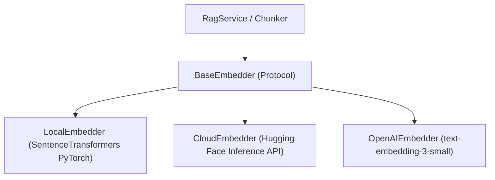

# Document Intelligence System — Version 2.0 Scope & Specification

## 1. Executive Summary & Objective

**Version 1.0** successfully proved the local mechanics of Grounded Retrieval-Augmented Generation (RAG):
- 1-based PDF extraction (`pypdf`)
- Unicode NFKC text cleaning
- Local cosine-drop semantic chunking (80th percentile)
- Local dense embeddings (`all-MiniLM-L6-v2`) in ChromaDB
- Grounded generation with regex-extracted inline citations (`[Page X]`)
- Empirical IR evaluation (**Recall@5: 100%**, **MRR: 0.83**)

**Version 2.0** transitions the architecture from a single-user local prototype into a **cloud-deployable, memory-efficient, multi-tenant RAG platform**.

---

## 2. Core V2 Architectural Goals

1. **Pluggable Embedding Architecture**:
   - Decouple embedding generation behind an abstract `BaseEmbedder` interface.
   - Support both **`LocalEmbedder`** (current PyTorch CPU SentenceTransformer) and **`CloudEmbedder`** (Hugging Face Serverless Inference API / OpenAI).
   - **Impact**: Reduces backend memory consumption from **~900 MB to ~60 MB**, enabling free deployment on FastAPI Cloud, Render, and serverless platforms without `OOMKilled` crashes.

2. **Multi-Tenancy & Session Isolation**:
   - Parameterize vector storage by `session_id` (`collection_name = f"session_{session_id}"`).
   - Enable independent document workspaces where concurrent users do not share, leak, or overwrite each other's vector embeddings.

3. **Multi-Document Corpus Querying**:
   - Support uploading and indexing multiple PDFs within the same workspace session.
   - Upgrade citation attribution from single-document `[Page X]` to cross-document `[File: program.pdf • Page X]`.

4. **Automated RAG Triad Evaluations**:
   - Complement V1's retrieval benchmarks (Recall & MRR) with generation quality metrics:
     - **Faithfulness / Groundedness**: Verifying every claim against retrieved context.
     - **Answer Relevance**: Verifying the response directly addresses the user query.
     - **Context Precision**: Evaluating signal-to-noise ratio in retrieved chunks.

---

## 3. Component Deep Dive

### 3.1 Pluggable Embedder Protocol (`backend/src/document_intelligence/processing/embedder.py`)



#### Protocol Specification:
```python
from typing import Protocol
import numpy as np
from document_intelligence.models.chunk import Chunk, EmbeddedChunk

class BaseEmbedder(Protocol):
    def encode(self, text: str) -> np.ndarray: ...
    def embed_chunks(self, chunks: list[Chunk]) -> list[EmbeddedChunk]: ...
```

- **Environment Config**: `EMBEDDER_BACKEND=local|cloud_hf|openai`.
- **Default**: Auto-fallbacks to `local` if no API key is provided, or `cloud_hf` when running in low-memory environments.

---

### 3.2 Session-Scoped Vector Storage (`backend/src/document_intelligence/storage/`)

#### Multi-Tenant Architecture:
1. Every API request passes or receives an `X-Session-ID` header (or cookie).
2. The storage engine isolates collections deterministically:
   $$\text{Collection Name} = \text{hash}(\text{session\_id})[:16]$$
3. Clear/Purge operations (`DELETE /api/v1/documents`) only purge the caller's specific session collection.

---

### 3.3 Multi-Document Corpus Attribution

To support cross-referencing multiple PDFs in one session:
- **Chunk Metadata**:
  ```python
  {
      "document_id": str,
      "file_name": str,
      "page_number": int,
      "chunk_index": int,
  }
  ```
- **Context Injection**:
  ```xml
  <context>
    <chunk file="syllabus.pdf" page="1">...</chunk>
    <chunk file="regulations.pdf" page="4">...</chunk>
  </context>
  ```
- **Citation Syntax**: `[syllabus.pdf • Page 1]` and `[regulations.pdf • Page 4]`.

---

### 3.4 Evaluation Suite Expansion (The RAG Triad)

| Metric | Target | Formula / Evaluation Method |
| :--- | :--- | :--- |
| **Recall@5** (Retrieval) | $\ge 0.95$ | Context chunk in top-5 nearest neighbors (from V1). |
| **MRR** (Retrieval) | $\ge 0.80$ | Mean Reciprocal Rank of target chunks (from V1). |
| **Faithfulness** (Generation) | $\ge 0.90$ | $\frac{|\text{Grounded Statements}|}{|\text{Total Statements in Answer}|}$ |
| **Answer Relevance** (Generation) | $\ge 0.85$ | Semantic similarity between generated answer and question embedding. |

---

## 4. Scope Governance & Boundaries for V2

### Strictly IN SCOPE for V2:
1. `BaseEmbedder` protocol and `CloudEmbedder` HTTP adapter.
2. Session-based collection partitioning in ChromaDB.
3. Multi-document upload and multi-document citation tracking in API and Frontend.
4. RAG Triad evaluation metrics harness in `tests/evaluation/`.
5. Frontend support for multiple document tabs and file-specific citation badges.

### Strictly OUT OF SCOPE for V2:
1. **Kubernetes / Celery Distributed Queues**: Keep infrastructure lightweight; no Kafka or Celery workers.
2. **Complex Multi-Agent Frameworks**: Keep business logic pure Python; no AutoGen, CrewAI, or LangChain chains.
3. **OCR for Scanned Handwriting**: Focus strictly on digital PDFs and academic documents.
4. **Relational Database Migrations**: Storage remains strictly managed via Vector DB abstractions.
